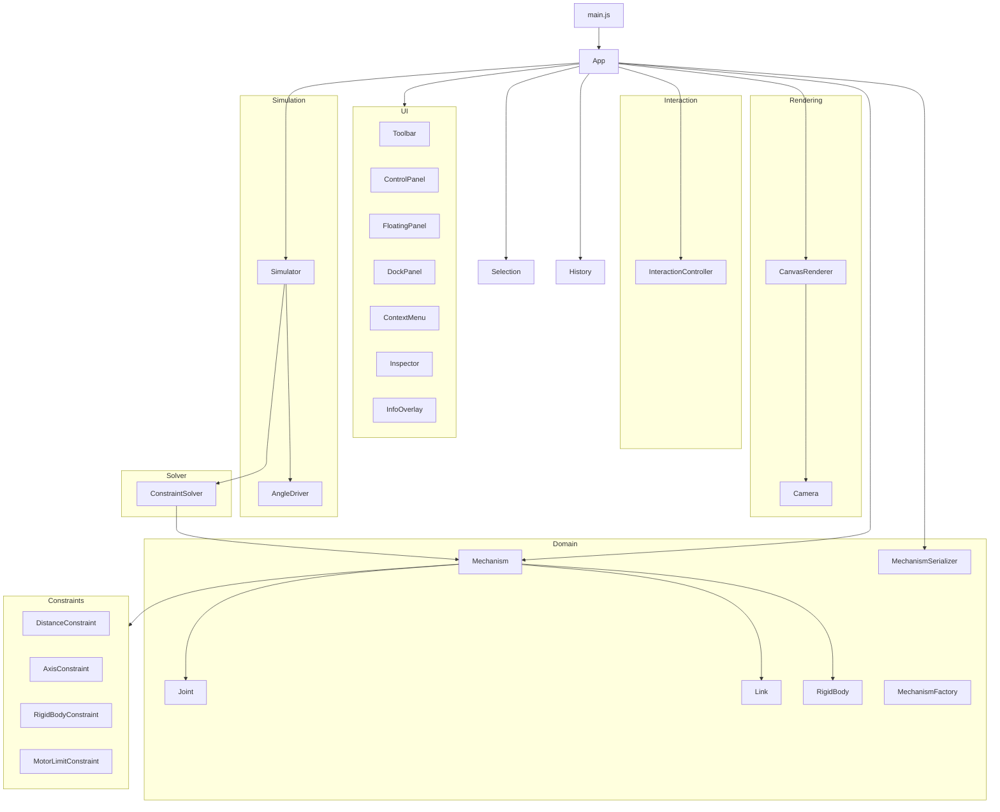
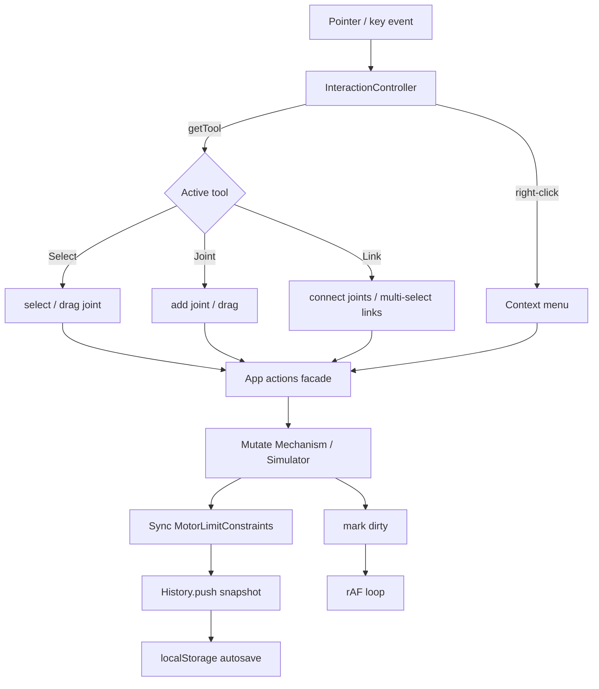
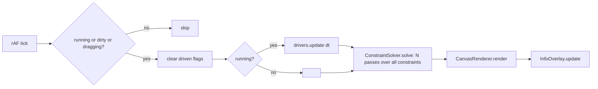
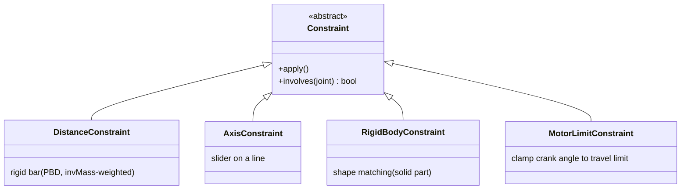

# MechSim — Design

## Overview

MechSim is a layered, SOLID-structured Vite app. A single composition root
(`App`) wires independent layers together and runs a `requestAnimationFrame`
loop. Each layer below `App` is unaware of the others and depends only on
abstractions (`Constraint`, `Driver`, `IRenderer`), so new joint types,
constraints, drivers, and tools slot in without touching the solver or domain.

## Module layers

## Edit flow (pointer → scene → render)

## Simulation loop

## Constraint model (Open/Closed seam)

Every rule implements `Constraint.apply()`; the solver relaxes them in Gauss–
Seidel fashion for N iterations and knows nothing about concrete types.

- **invMass** abstraction: a joint is immovable (invMass 0) when `fixed`,
  `driven`, or `dragging`. The solver only sees invMass, not *why*.
- **Shape matching** (RigidBody): best-fit rigid transform of the frozen rest
  shape onto current pivots each pass, snapping free pivots back — stiff and
  stable, works for collinear parts.
- **Motor limit** is a constraint (not driver-only), so the travel range holds
  even while dragging with the sim paused.

## Motor (AngleDriver)

- Parameters: `speed` (deg/s), `inverted`, `zeroDegrees` (world-angle of 0°:
  3→0, 12→90, 9→180, 6→270), `limitDegrees` (<360 ping-pongs within the arc).
- `measuredAngleDegrees()` reports the angle from zero (honoring invert) from
  live positions, so Info is correct while paused.

## Persistence & history

- `MechanismSerializer` is the single source of truth for scene <-> plain
  object: it powers **undo/redo snapshots**, **localStorage autosave**, and
  **.mechsim import/export**. On load it assigns fresh ids and rewires by a
  local id map to avoid collisions. Derived constraints (rigid-body shape match,
  motor limits) are rebuilt from bodies/motors, not serialized.
- `History` stores whole-scene snapshots; `present` mirrors the live scene.

## Rendering & coordinates

- `Camera` converts world mm <-> screen px (Y-up world, Y-down screen) and owns
  pan/zoom. The rest of the app reasons purely in millimeters.
- `CanvasRenderer` draws grid, slider tracks, motor arcs, rigid bodies (filled
  hull / collinear capsule + struts), links (with length/name labels), joints
  (grounded square / free ring), selection (green), hover (orange), link-start
  ring, and optional subtle name labels.

## Interaction tools (Strategy via `getTool`)

| Tool   | Click empty | Click joint | Click link | Drag joint | Right-click |
|--------|-------------|-------------|------------|------------|-------------|
| Select | clear sel   | select+edit | select     | move       | context menu |
| Joint  | add joint   | select+move | —          | move       | context menu |
| Link   | clear start | chain links | toggle sel | —          | convert/color |

Shared: middle-drag pan, wheel zoom, hover highlight (cross-linked to panel).
